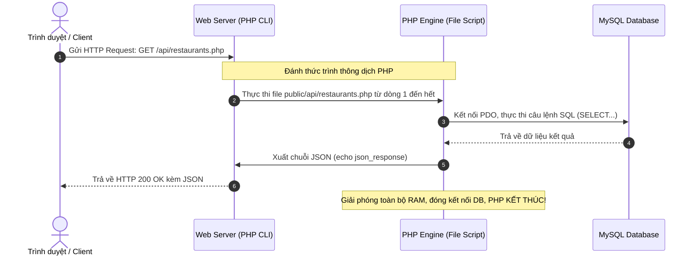

# HƯỚNG DẪN DÀNH CHO LẬP TRÌNH VIÊN SPRING BOOT & REACTJS 🚀
### Làm Chủ Nhanh Dự Án Food Finder (PHP Thuần & Vanilla JavaScript ES Modules)

> **Mục tiêu**: Giúp bạn chuyển đổi tư duy kỹ thuật (Mental Model) từ **Java Spring Boot + ReactJS** sang **PHP thuần (Vanilla PHP) + Vanilla JS**, hiểu rõ bản chất cách dự án khởi động, cấu hình và vận hành.

---

## 1. BẢNG SO SÁNH ÁNH XẠ 1-1: SPRING BOOT / REACTJS vs PHP THUẦN

| Khái Niệm / Thành Phần | Bạn Đã Quen Trong Spring Boot / ReactJS | Tương Đương Trong Dự Án Food Finder |
| :--- | :--- | :--- |
| **File cấu hình ứng dụng** | `application.properties` hoặc `application.yml` | [`app/config.php`](./app/config.php) (chứa `DB_HOST`, `DB_USER`, `DB_PASS`, `DB_NAME`...) |
| **Web Server** | Tomcat nhúng sẵn (`mvn spring-boot:run` chạy port 8080) | **PHP Built-in Server** chạy lệnh `php -S localhost:8000 -t public` |
| **Định tuyến API (Routing)** | `@RestController` + `@GetMapping("/api/restaurants")` | **Đường dẫn file chính là Route!** URL `/api/restaurants.php` trỏ thẳng vào file [`public/api/restaurants.php`](./public/api/restaurants.php) |
| **Tương tác Cơ sở dữ liệu** | Spring Data JPA / Hibernate (`JpaRepository`, `@Entity`) | **PDO (PHP Data Objects)** trong [`app/db.php`](./app/db.php) + SQL Prepared Statement |
| **Dependency Injection** | `@Autowired`, Spring IoC Container | `require_once __DIR__ . '/db.php';` (Nhúng trực tiếp file hàm cần dùng) |
| **Phản hồi dữ liệu JSON** | `ResponseEntity.ok(dto)` (Jackson tự serialize) | `echo json_encode($data);` hoặc hàm `json_response($data)` trong [`app/response.php`](./app/response.php) |
| **Bộ lọc & Bảo mật** | Spring Security + `OncePerRequestFilter` | File [`_bootstrap.php`](./public/admin/_bootstrap.php) hoặc hàm helper trong [`app/auth.php`](./app/auth.php) |
| **Đóng gói Frontend** | Node.js + npm + Vite/Webpack build JSX thành bundle | **Trình duyệt tự nạp trực tiếp** file `.html` và `.js` qua chuẩn ES Modules `<script type="module">` |
| **Giao diện & Thành phần** | Component JSX: `<RestaurantCard data={item} />` | JavaScript Template String: `element.innerHTML = \`<div>${item.name}</div>\`` |

---

## 2. BẢN CHẤT NGÔN NGỮ PHP: NÓ CHẠY NHƯ THẾ NÀO?

### 🔄 Vòng Đời Một Request (Share-Nothing Architecture)
Khác với Spring Boot (ứng dụng Java bật lên là Tomcat và các Bean `@Service`, `@Repository` sẽ sống vĩnh viễn trong bộ nhớ RAM cho đến khi bạn tắt server):



> [!TIP]
> **Điểm cộng cực lớn khi phát triển**: Vì PHP không nạp bean vào RAM lâu dài, **mỗi khi bạn sửa bất kỳ file `.php` nào, bạn chỉ cần F5 (Reload) lại trình duyệt là thấy ngay kết quả**, không cần chờ Maven build hay Restart server như Spring Boot!

---

## 3. CẦN CÀI ĐẶT NHỮNG GÌ ĐỂ MÁY TÍNH CHẠY ĐƯỢC PHP?

Để chạy dự án, máy tính Windows của bạn chỉ cần:
1. **PHP Runtime (bản 8.1 trở lên)**: Trình thông dịch để đọc code PHP.
2. **MySQL Server**: Cơ sở dữ liệu lưu trữ quán ăn, danh mục, admin.

### Cách phổ biến nhất trên Windows: Cài đặt XAMPP
* **XAMPP** là gói phần mềm tích hợp sẵn cả **PHP** (`C:\xampp\php\php.exe`) và **MySQL** (`C:\xampp\mysql\bin\mysql.exe`).
* Sau khi cài XAMPP:
  1. Mở **XAMPP Control Panel**.
  2. Bấm nút **Start** ở dòng **MySQL** (cổng mặc định 3306).
  3. *(Không bắt buộc phải bật Apache của XAMPP, vì dự án đã có sẵn script chạy Web Server độc lập).*

---

## 4. GIẢI THÍCH CHI TIẾT 2 FILE CHẠY TỰ ĐỘNG (.BAT)

### 📁 File 1: `setup_database.bat` (Khởi tạo CSDL 1-Click)
Tương tự như việc chạy migration Flyway/Liquibase trong Spring Boot:
* Script tự động tìm đến `C:\xampp\mysql\bin\mysql.exe`.
* Tự động chạy lệnh SQL:
  ```sql
  CREATE DATABASE IF NOT EXISTS food_finder CHARACTER SET utf8mb4 COLLATE utf8mb4_unicode_ci;
  ```
* Nạp cấu trúc bảng từ [`database/schema.sql`](./database/schema.sql) (tương tự DDL `@Entity`).
* Nạp dữ liệu mẫu danh mục và quán ăn từ [`seed_categories.sql`](./database/seed_categories.sql) và [`seed_restaurants.sql`](./database/seed_restaurants.sql).

### 📁 File 2: `start_server.bat` (Khởi động Server 1-Click)
Tương tự như lệnh `mvn spring-boot:run`:
* Script gọi chương trình:
  ```cmd
  "C:\xampp\php\php.exe" -S localhost:8000 -t "%~dp0public"
  ```
* **Giải thích các tham số**:
  * `-S localhost:8000`: Mở một Web Server HTTP tích hợp sẵn của PHP lắng nghe tại cổng `8000`.
  * `-t public`: Đặt thư mục **Document Root** là `public/`.
* **Ý nghĩa bảo mật**:
  * Trình duyệt chỉ có thể truy cập các file nằm trong thư mục `public/`.
  * Thư mục chứa code nghiệp vụ nhạy cảm [`app/`](./app/) và [`database/`](./database/) nằm ngoài `public/`, do đó người ngoài tuyệt đối không thể xem trộm file cấu hình mật khẩu hay source code qua URL.

---

## 5. CẤU HÌNH KẾT NỐI DATABASE (`app/config.php`)

File này tương đương với `application.properties`:
```php
<?php
declare(strict_types=1);

const APP_ENV   = 'development';
const DB_HOST   = '127.0.0.1';    // Địa chỉ server MySQL
const DB_PORT   = 3306;           // Cổng MySQL
const DB_NAME   = 'food_finder';  // Tên Database
const DB_USER   = 'root';         // Tài khoản (mặc định XAMPP là 'root')
const DB_PASS   = '';             // Mật khẩu (mặc định XAMPP để trống)
const APP_URL   = 'http://localhost:8000';
```

---

## 6. FRONTEND HOẠT ĐỘNG THẾ NÀO MÀ KHÔNG CẦN REACT HAY NODE.JS?

Nếu bạn quen dùng ReactJS với `npm run dev`, bạn sẽ thắc mắc: *"Tại sao không có `package.json`, không có Vite, không có build mà web vẫn chạy được?"*

### 1. Chuẩn Native ES Modules
Trong [`public/index.html`](./public/index.html), bạn thấy thẻ:
```html
<script type="module" src="./assets/js/main.js"></script>
```
* Trình duyệt hiện đại (Chrome, Edge, Firefox) đã hỗ trợ sẵn từ khoá `import` và `export`.
* Khi `main.js` gọi:
  ```javascript
  import { initMap } from './map.js';
  import { fetchRestaurants } from './api.js';
  ```
  Trình duyệt sẽ tự động gửi HTTP Request tải các file `.js` này về và liên kết chúng lại, **hoàn toàn không cần Webpack hay Vite đóng gói**.

### 2. Render UI không cần JSX
Thay vì viết JSX Component và Virtual DOM như React:
```javascript
// React:
// return <div className="card"><h3>{item.name}</h3></div>;

// Vanilla JS trong dự án này (list.js):
container.innerHTML = restaurants.map(r => `
  <article class="restaurant-card" data-id="${r.id}">
    <h3>${r.name}</h3>
    <span class="rating">⭐ ${r.rating}</span>
  </article>
`).join('');
```

### 3. Cơ chế Mock Data Fallback thông minh
Trong [`public/assets/js/api.js`](./public/assets/js/api.js):
* Hàm `fetchRestaurants()` sẽ gửi `fetch()` đến PHP API.
* Nếu MySQL chưa bật hoặc PHP bị lỗi, khối `catch` sẽ **tự động chuyển sang lấy dữ liệu mẫu** từ [`mock-data.js`](./public/assets/js/mock-data.js).
* Nhờ vậy, ngay cả khi người dùng mở trực tiếp file HTML hoặc server chưa kết nối DB, giao diện vẫn hiển thị đẹp mắt để xem trước.

---

## 7. QUY TRÌNH 3 BƯỚC KHỞI ĐỘNG VÀ TEST DỰ ÁN

```
[Bước 1] Mở XAMPP -> Bấm [Start] tại dòng MySQL
   │
   ▼
[Bước 2] Nhấp đúp chuột file: setup_database.bat (Nạp CSDL)
   │
   ▼
[Bước 3] Nhấp đúp chuột file: start_server.bat (Khởi động Server)
```

Sau khi chạy xong:
* **Giao diện Người dùng**: `http://localhost:8000`
* **Giao diện Quản trị Admin**: `http://localhost:8000/admin/`
  * Tài khoản: `admin`
  * Mật khẩu: `Admin@123456`

---

## 8. BẢN ĐỒ CHỈ DẪN CODE: "MUỐN SỬA GÌ THÌ SỬA Ở FILE NÀO?"

* **Muốn đổi toạ độ mặc định của bản đồ**: Sửa `DEFAULT_LOCATION` trong [`public/assets/js/config.js`](./public/assets/js/config.js).
* **Muốn sửa giao diện / màu sắc / font chữ**: Sửa các biến CSS trong [`public/assets/css/tokens.css`](./public/assets/css/tokens.css).
* **Muốn viết thêm 1 API mới**: 
  1. Tạo file mới trong `public/api/ten_api.php`.
  2. Nạp file kết nối: `require_once __DIR__ . '/../../app/db.php';`
  3. Viết câu lệnh SQL PDO và trả về kết quả qua `json_response($data)`.
  4. Viết hàm gọi trong [`public/assets/js/api.js`](./public/assets/js/api.js).
* **Muốn tắt server**: Quay lại cửa sổ dòng lệnh của `start_server.bat` và bấm tổ hợp phím **`Ctrl + C`**.
