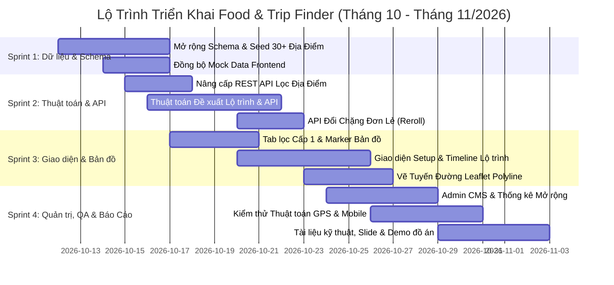

# Kế Hoạch & Tổng Quan Dự Án Food & Trip Finder 🍜🏛️🎡

> **Dự án**: Food & Trip Finder — Nền tảng bản đồ thông minh tích hợp tìm kiếm quán ăn/uống, địa điểm du lịch, khu vui chơi và **Tự động đề xuất lộ trình đi chơi quanh vị trí người dùng**.  
> **Khu vực dữ liệu mẫu**: Quanh Trường Đại học Tôn Đức Thắng (TDTU), Quận 7, TP. Hồ Chí Minh & các điểm du lịch tiêu biểu tại TP.HCM.  
> **Cập nhật ngày**: 11/10/2026.  
> **Tài liệu theo dõi công việc**: [`FoodFinder_Project_Plan.xlsx`](./FoodFinder_Project_Plan.xlsx) & [`FoodFinder_Project_Plan.csv`](./FoodFinder_Project_Plan.csv).

---

## 1. TỔNG QUAN ĐỊNH HƯỚNG MỚI (NEW PROJECT SCOPE)

Từ định hướng ban đầu chỉ tập trung vào ẩm thực, dự án được nâng cấp toàn diện thành **Nền tảng Khám phá Thành phố & Lập Lịch Trình Thông Minh**:

1. **Mở rộng Hệ sinh thái Địa điểm (Places Expansion)**:
   * **Ẩm thực & Đồ uống (Food & Beverage 🍜)**: Quán ăn, cà phê, trà sữa, ăn vặt, nhà hàng tiệc nướng, món chay...
   * **Địa điểm Du lịch & Tham quan (Tourism & Sightseeing 🏛️)**: Di tích lịch sử, bảo tàng nghệ thuật, công viên cảnh quan, bến tàu, view ngắm hoàng hôn, cầu biểu tượng...
   * **Khu vui chơi & Trải nghiệm (Entertainment & Activities 🎡)**: Khu trò chơi vận động (trampoline, bowling), rạp chiếu phim, board game cafe, workshop thủ công mỹ nghệ, bắn cung, khu giải trí phức hợp...

2. **Tính năng Đột phá Cốt lõi: Đề xuất Lộ trình Đi chơi Thông minh (Smart Itinerary Generator 🗺️)**:
   * Tự động khởi tạo lịch trình dạo chơi nửa ngày hoặc cả ngày dựa trên **tọa độ GPS thực tế** của người dùng.
   * Kết hợp hài hòa giữa các hoạt động: **Ăn uống khởi đầu -> Tham quan / Vui chơi -> Ăn chính -> Thư giãn / Dạo phố**.
   * Thuật toán tối ưu hóa đường đi liên tục (Nearest Neighbor Heuristic), tránh đi vòng vèo zíc zắc hoặc ngược hướng.
   * Giao diện dòng thời gian (Timeline) trực quan, vẽ đường polyline kết nối các điểm trên nền Leaflet.js và tích hợp nút mở lộ trình đa điểm trực tiếp trên Google Maps.

---

## 2. KIẾN TRÚC & CÔNG NGHỆ (TECH STACK)

### 2.1. Frontend
* **HTML5 Semantic & Modern CSS**: Hệ thống Design Token Neo-Brutalism kết hợp Glassmorphism (`tokens.css`, `brutal.css`, `layout.css`). Hỗ trợ Light / Dark Mode.
* **Vanilla JavaScript ES6+**: Kiến trúc module độc lập (`map.js`, `filters.js`, `explore.js`, `itinerary.js`, `icons.js`...).
* **Bản đồ & Định vị**: Leaflet.js (v1.9.4) + MarkerCluster + OpenStreetMap + HTML5 Geolocation API (fallback TDTU Quận 7).
* **Tuyến đường (Routing Polyline)**: Vẽ đường lộ trình trên bản đồ, tích hợp link Multi-waypoint sang Google Maps (`https://www.google.com/maps/dir/...`).
* **Lưu trữ cục bộ**: LocalStorage lưu quán yêu thích và các lộ trình đã tạo.

### 2.2. Backend & Thuật toán
* **PHP 8.1+ RESTful API**: Cấu trúc nhẹ, không phụ thuộc framework cồng kềnh.
* **Thuật toán Địa lý (Geospatial Computation)**:
  * Bounding Box & Công thức Haversine Distance ($R = 6371.0088\text{ km}$).
  * Bộ lọc giờ mở cửa thực tế (`is_open_now`) hỗ trợ cả địa điểm mở đêm/24/7.
* **Thuật toán Đề xuất Lộ trình Thông minh (`app/itinerary.php`)**:
  * Nhận input: Vị trí xuất phát, Khung thời gian (Nửa ngày / Cả ngày / Buổi tối), Phong cách chuyến đi (Chill, Vui chơi năng động, Check-in sống ảo, Ăn sập), Bán kính.
  * Phân phối logic chặng dừng theo giờ mở cửa, loại hình và khoảng cách liền kề ngắn nhất.
  * Hỗ trợ API đổi chặng đơn lẻ (`api/itinerary_reroll.php`).
* **Bảo mật**: Anti-CSRF token, Session HttpOnly/SameSite, Brute-force IP protection, Upload validation qua MIME type thực tế.

### 2.3. Cơ sở dữ liệu (Database)
* **MySQL / MariaDB** (`utf8mb4_unicode_ci`).
* Mở rộng schema:
  * `places`: Mở rộng từ `restaurants` hoặc bảng chung, bổ sung cột `place_type` (`food`, `tourism`, `entertainment`), `ticket_price`, `estimated_duration` (phút), `best_time_slot`.
  * `categories`: Thêm cột `type_group` để phân nhóm cấp 1 (Ẩm thực, Du lịch, Vui chơi).
  * `itinerary_logs`: Nhật ký các lộ trình được tạo để đo lường KPI & phân tích thói quen người dùng.

---

## 3. FILE KẾ HOẠCH GOOGLE SHEETS & TIẾN ĐỘ THỰC HIỆN

Toàn bộ kế hoạch phân công công việc đã được cấu trúc thành trang tính chuyên nghiệp tại file:
* 📁 **File Excel**: [`FoodFinder_Project_Plan.xlsx`](./FoodFinder_Project_Plan.xlsx) (Đầy đủ 4 Sheet, định dạng màu sắc Neo-Brutalism, Dropdown Data Validation và Công thức tự động).
* 📁 **File CSV**: [`FoodFinder_Project_Plan.csv`](./FoodFinder_Project_Plan.csv) (Dùng import nhanh vào bất kỳ phần mềm bảng tính nào).

### 3.1. Hướng Dẫn Tải Lên Google Sheets (Chỉ mất 5 giây)
1. Mở trình duyệt và truy cập: **[sheets.new](https://sheets.new)** (tạo một Google Sheet trắng mới).
2. Trên thanh menu, chọn: **Tệp (File)** > **Mở (Open)** (hoặc phím tắt `Ctrl + O`).
3. Chọn tab **Tải lên (Upload)** và kéo thả file `FoodFinder_Project_Plan.xlsx` từ thư mục dự án vào.
4. Google Sheets sẽ tự động chuyển đổi thành 1 bảng tính Google Sheet trực tuyến hoàn chỉnh với đầy đủ công thức, màu sắc, dropdown và phân quyền chia sẻ cho nhóm!

---

## 4. CHI TIẾT BẢNG PHÂN CÔNG TASK (TASK BREAKDOWN)

| Mã Task | Phân Hệ | Tên Công Việc | Mô Tả & Tiêu Chí Nghiệm Thu | Độ Ưu Tiên | Trạng Thái | Hạn Chót |
| :--- | :--- | :--- | :--- | :---: | :---: | :---: |
| **DB-01** | Database | Mở rộng Schema hỗ trợ Đa loại hình địa điểm | Mở rộng bảng `restaurants` (hoặc `places`) thêm: `place_type` ('food', 'tourism', 'entertainment'), `ticket_price`, `estimated_duration`, `best_time_slot`. | **P1 - Cao** | To Do | 14/10/2026 |
| **DB-02** | Database | Mở rộng Bảng Danh Mục theo 3 Nhóm lớn | Thêm `type_group` vào bảng `categories`. Seed danh mục Du lịch (Bảo tàng, Di tích, Công viên) & Vui chơi (Khu trò chơi, Rạp phim, Boardgame, Workshop). | **P1 - Cao** | To Do | 14/10/2026 |
| **DB-03** | Database | Thu thập dữ liệu & Seed 30+ Điểm Du lịch & Vui chơi | Soạn `seed_places_expansion.sql` bổ sung 30+ địa điểm thực tế quanh Q7/TPHCM (Cầu Ánh Sao, Hồ Bán Nguyệt, Artinus 3D, Jump Arena, Thảo Cầm Viên, Landmark 81...) kèm GPS, giá vé, giờ mở cửa. | **P1 - Cao** | To Do | 16/10/2026 |
| **DB-04** | Frontend | Cập nhật Mock Data Frontend (`mock-data.js`) | Đồng bộ toàn bộ điểm Du lịch và Vui chơi vào `mock-data.js` để app chạy demo tĩnh mượt mà khi chưa bật backend PHP. | **P2 - TB** | To Do | 16/10/2026 |
| **BE-01** | Backend | RESTful API Lấy địa điểm theo loại hình | Nâng cấp `/api/restaurants.php` (hoặc `/api/places.php`) nhận tham số `type=all\|food\|tourism\|entertainment`, `min_price`, `max_price`, tính khoảng cách Haversine. | **P1 - Cao** | To Do | 17/10/2026 |
| **BE-02** | Backend | Thiết kế Thuật toán Đề xuất Lộ trình (`app/itinerary.php`) | Xây dựng thuật toán ghép lịch trình: Vị trí hiện tại -> [Ăn sáng/Cafe] -> [Khu vui chơi/Điểm tham quan] -> [Ăn trưa/tối] -> [Chill ngắm cảnh]. Sắp xếp theo khoảng cách ngắn nhất (Nearest Neighbor). | **P1 - Cao** | To Do | 20/10/2026 |
| **BE-03** | Backend | Endpoint API Đề xuất Lộ trình (`/api/itinerary.php`) | API nhận: `user_lat`, `user_lng`, `duration` (half_day/full_day/evening), `vibe`, `max_radius`. Trả về JSON: tổng km, tổng giờ dự kiến, danh sách stops kèm thời gian đề xuất. | **P1 - Cao** | To Do | 21/10/2026 |
| **BE-04** | Backend | API Đổi Chặng Đơn Lẻ (`/api/itinerary_reroll.php`) | Cho phép đổi 1 địa điểm trong chặng bất kỳ sang địa điểm tương đương gần đó mà không làm xáo trộn các chặng còn lại. | **P2 - TB** | To Do | 22/10/2026 |
| **FE-01** | Frontend | Nâng cấp Bộ lọc Nhóm Địa Điểm trên Bản đồ & Explore | Thêm thanh Tabs chọn nhóm: [Tất cả] [🍜 Ẩm thực] [🏛️ Du lịch] [🎡 Vui chơi giải trí] trên `index.html` và `explore.html`. | **P1 - Cao** | To Do | 19/10/2026 |
| **FE-02** | Frontend | Marker & Icon Riêng Biệt cho Từng Loại Địa Điểm | Đỏ/cam cho Quán ăn; Xanh lam cho Du lịch; Vàng/cam neon cho Vui chơi. Cập nhật SVG icon vào `icons.js`. | **P2 - TB** | To Do | 20/10/2026 |
| **FE-03** | Frontend | Cập nhật Thẻ Địa Điểm & Trang Chi Tiết | Hiển thị badge loại địa điểm, giá vé tham quan, thời lượng trải nghiệm đề xuất (Ví dụ: "Thời lượng: ~90 phút"). | **P2 - TB** | To Do | 21/10/2026 |
| **FE-04** | Frontend | Giao diện Thiết lập Lộ trình (Itinerary Setup Modal) | Form chọn: Thời lượng chuyến đi (Nửa ngày / Cả ngày / Tối), Vibe (Chill, Hẹn hò, Trải nghiệm, Ăn sập), Bán kính. Nút "Tạo lộ trình ngay". | **P1 - Cao** | To Do | 23/10/2026 |
| **FE-05** | Frontend | Giao diện Timeline Lịch trình Thông minh | Dòng thời gian trực quan (09:00 -> 11:30...), Thẻ địa điểm, Khoảng cách từng chặng, Nút "Đổi địa điểm khác" (Reroll). | **P1 - Cao** | To Do | 25/10/2026 |
| **FE-06** | Frontend | Vẽ Tuyến Đường Đa Điểm trên Leaflet (Polyline) | Vẽ đường Polyline nối Vị trí người dùng -> Điểm 1 -> Điểm 2 -> Điểm 3... Đánh số thứ tự Marker [1][2][3]. Nút mở toàn bộ lộ trình trên Google Maps. | **P1 - Cao** | To Do | 26/10/2026 |
| **FE-07** | Frontend | Lưu & Chia Sẻ Lộ Trình (LocalStorage & Share) | Lưu các lộ trình đã tạo vào danh sách cá nhân và chia sẻ lộ trình qua Web Share API / Copy Link. | **P3 - Thấp** | To Do | 27/10/2026 |
| **ADM-01** | Admin | Cập nhật Quản Trị Đa Loại Hình trong Admin CMS | Thêm trường chọn Loại hình, giá vé, thời lượng ghé thăm trong trang thêm/sửa địa điểm của Admin CMS. | **P2 - TB** | To Do | 26/10/2026 |
| **ADM-02** | Admin | Thống kê Dashboard Quản Trị Mở Rộng | Cập nhật biểu đồ cơ cấu địa điểm (Ăn uống vs Du lịch vs Vui chơi) và thống kê lượt tạo lộ trình. | **P3 - Thấp** | To Do | 28/10/2026 |
| **QA-01** | QA | Kiểm thử Logic Thuật toán Lộ trình | Test với các toạ độ GPS khác nhau quanh TP.HCM: TDTU Quận 7, Bến Bạch Đằng, Sala Thủ Thiêm; đảm bảo lộ trình hợp lý và không ngược chiều. | **P1 - Cao** | To Do | 28/10/2026 |
| **QA-02** | QA | Kiểm thử Responsive Mobile & Hiệu năng Bản đồ | Kiểm tra trên thiết bị di động thực tế (iOS, Android), thao tác vuốt chạm bản đồ, độ mượt khi zoom và tải nhiều marker/polyline. | **P2 - TB** | To Do | 30/10/2026 |
| **DOC-01** | Docs | Cập nhật Báo Cáo Kỹ Thuật, Sơ Đồ ERD & Thuật Toán | Vẽ sơ đồ hoạt động (Flowchart Lộ trình), sơ đồ Use-Case, cập nhật ERD database và tài liệu API. | **P2 - TB** | To Do | 31/10/2026 |
| **DOC-02** | Docs | Chuẩn bị Slide Thuyết Trình & Kịch bản Demo Đồ án | Thiết kế slide báo cáo tổng kết, kịch bản demo làm nổi bật tính năng gợi ý lịch trình thông minh. | **P2 - TB** | To Do | 02/11/2026 |

---

## 5. LỘ TRÌNH 4 GIAI ĐOẠN (SPRINT TIMELINE)

---

## 6. MA TRẬN PHÂN CÔNG VAI TRÒ (RACI MATRIX)

| STT | Hạng Mục Công Việc | Team Leader | Frontend Dev | Backend Dev | QA & Data Lead |
| :---: | :--- | :---: | :---: | :---: | :---: |
| 1 | Mở rộng CSDL & Dữ liệu 30+ điểm du lịch/vui chơi | **A** | I | **R** | **R** |
| 2 | Thuật toán Đề xuất Lộ trình & Backend API | **A** | C | **R** | C |
| 3 | Giao diện Timeline & Thiết lập Lộ trình | **A** | **R** | C | I |
| 4 | Vẽ tuyến đường Leaflet Polyline & Google Maps Multi-stop | **A** | **R** | C | I |
| 5 | Bộ lọc danh mục cấp 1 & Marker bản đồ tùy biến | **A** | **R** | C | I |
| 6 | Admin CMS Quản trị địa điểm mở rộng | **A** | C | **R** | I |
| 7 | Kiểm thử Thuật toán GPS & Responsive Mobile | **A** | C | C | **R** |
| 8 | Báo cáo đồ án, Slide thuyết trình & Video demo | **R** | C | C | **R** |

*(Ghi chú: **R** = Responsible - Người trực tiếp thực hiện; **A** = Accountable - Người chịu trách nhiệm chính; **C** = Consulted - Người được tham vấn ý kiến; **I** = Informed - Người nhận thông tin).*
